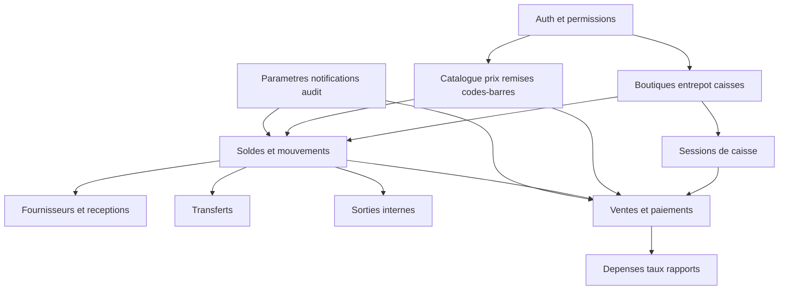
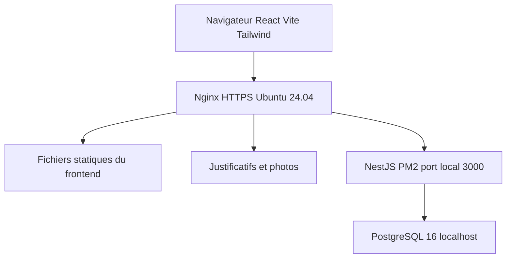
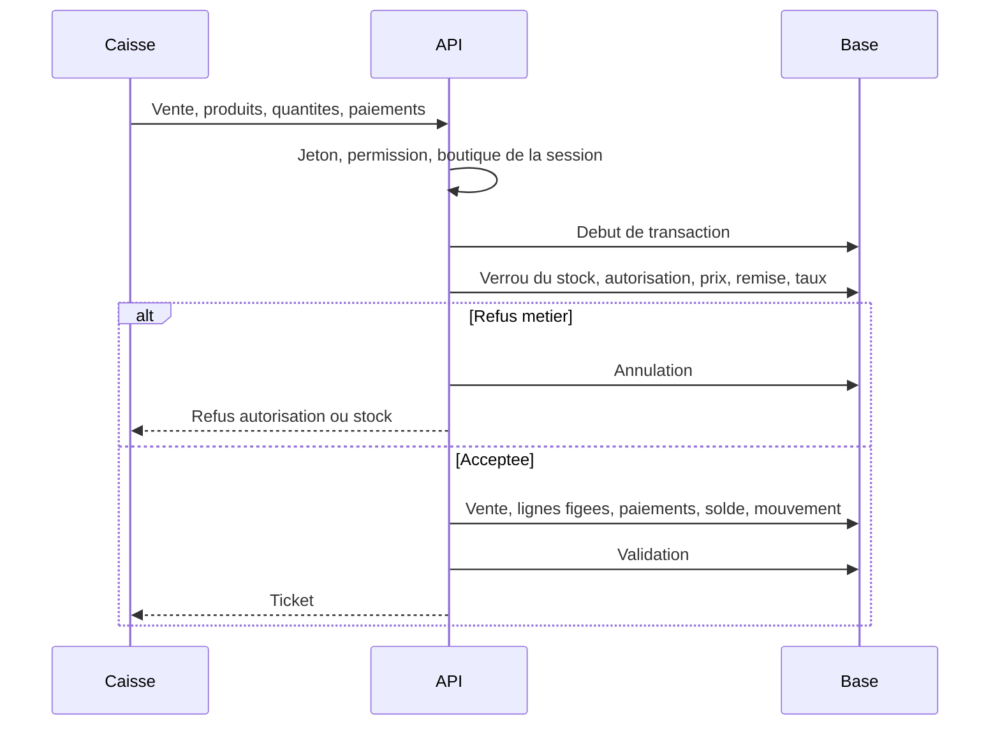
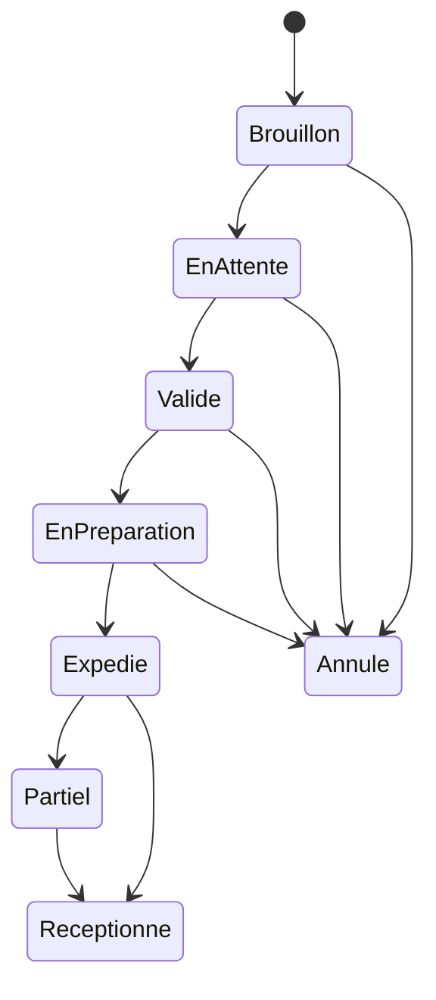
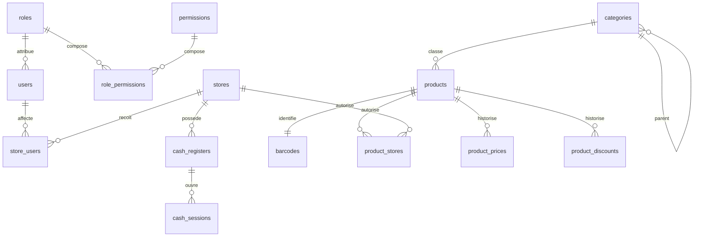
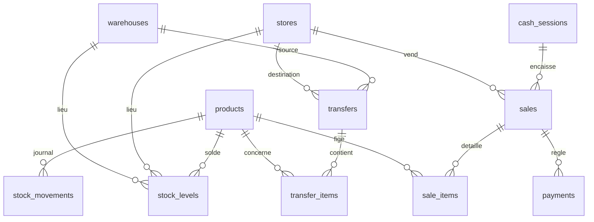

# Eyano — Analyse et conception

**Statut (2026-11-25) :** paliers 1–2, 8–9, 12 validés ; paliers 3–20 largement développés (cf. [PALIERS.md](./PALIERS.md)). Décisions A1–A18 retenues. Schéma Prisma et migrations en place (`backend/prisma/`). **Extension inventaires physiques** : module `inventory` livré volontairement hors périmètre « hors v1 » initial — tracé dans PALIERS.md, à valider avec le MOA.

Document de référence produit à partir du cahier des charges fonctionnel et technique Eyano. Il fige la lecture du cahier, les décisions métier encore ouvertes, l’architecture, le modèle de données, les permissions, les règles de stock, de prix et de paramètres, ainsi que le déploiement natif sur VPS, sans Docker. **Les sessions d’inventaire physique ne figurent pas dans ce périmètre documenté** (hors version 1).

Périmètre de la première version : gestion commerciale, financière et logistique des boutiques physiques et de l’entrepôt central. La vente en ligne est hors périmètre.

Eyano est un back-office central couplé à un point de vente par boutique. Le catalogue, le prix officiel et la remise appartiennent à l’administration centrale. Le stock appartient à un lieu : l’entrepôt ou une boutique. La caisse demande une validation ; le serveur relit le prix, la remise, l’autorisation et le stock, puis enregistre la vente dans une transaction.

La mention « HD-Eyano » au chapitre des prix du cahier désigne le même produit.

---

## Décisions métier à confirmer

Les points A1 à A14 et A16 à A18 sont des choix métier que le cahier ne tranche pas. L’architecture technique de ce document est la proposition soumise à validation (l’ancienne décision A15 « inventaire » est retirée du périmètre).

| # | Sujet | Proposition |
|---|---|---|
| A1 | Devise du catalogue | Prix d’achat, prix officiel et prix final en USD, comme les exemples du cahier. Le CDF sert aux encaissements, aux dépenses et aux décaissements. |
| A2 | Paiement mixte | Une vente peut cumuler plusieurs lignes : espèces USD, espèces CDF, M-Pesa, Orange Money, Airtel Money. La somme convertie en USD égale le total. |
| A3 | Taux | L’encaissement (seed 24 000) convertit un paiement de vente. Le décaissement (seed 22 500) convertit une dépense. Chaque pièce copie le taux utilisé. |
| A4 | Arrondi | Le prix unitaire final est arrondi avant multiplication par la quantité. Mode initial : half-up. USD à 2 décimales, CDF sans décimale. Le mode et l’échelle sont des paramètres. |
| A5 | Marge et valorisation | La marge d’une vente utilise le prix d’achat figé sur la ligne. La valorisation de stock est quantité × prix d’achat courant du catalogue. Le coût moyen pondéré est reporté. |
| A6 | Annulation | Un profil habilité peut annuler une vente entière. L’annulation crée un mouvement de stock inverse et passe la vente au statut annulé. La suppression physique est impossible. Le remboursement partiel d’une ligne est hors version 1. |
| A7 | Caisse | Une caisse par boutique en version 1. Le schéma accepte plusieurs caisses plus tard. Une seule session ouverte par caisse. |
| A8 | Sens des transferts | Le document de transfert va de l’entrepôt vers une boutique. Le retour physique, rare, passe par deux ajustements justifiés et tracés, en attendant un type de document dédié si vous le demandez. |
| A9 | Réservation | La validation d’un transfert réserve la quantité à l’entrepôt. L’expédition sort le physique. La réception entre en boutique la quantité réellement reçue. |
| A10 | Écart d’expédition | L’écart expédié / reçu est obligatoire à signaler. Le manquant ne réintègre pas l’entrepôt tout seul. Il reste sorti, visible, et se régularise par un ajustement justifié. |
| A11 | Autorisation et transfert | Un transfert vers une boutique n’est possible que si le produit y est déjà autorisé. Recevoir du stock ne crée pas l’autorisation. Retirer l’autorisation bloque les ventes nouvelles et laisse le stock visible. |
| A12 | Seuil d’alerte | Le seuil s’applique par lieu (entrepôt et chaque boutique). Défaut 100, surchargeable sur la fiche produit. Il compare la quantité physique. Il notifie. Il ne bloque pas la vente. |
| A13 | Quantités | Quantités entières. Un article se vend à l’unité. |
| A14 | Remise à 100 % | Une remise de 0 à 100 % est acceptée. À 100 %, le prix final est nul et le stock baisse quand même. |
| A16 | Caisse et dépenses | Une dépense en espèces rattachée à la session ouverte entre dans le solde théorique du tiroir. Le Mobile Money est totalisé à part et ne crée pas d’écart d’espèces. |
| A17 | Hors version 1 | Pas de clients nominatifs, pas de TVA, pas de vente en ligne, pas de mode hors ligne, pas d’appel API vers les opérateurs Mobile Money. La référence Mobile Money est saisie à la main. |
| A18 | Société unique | Une entreprise, un entrepôt central exploité, plusieurs boutiques. La fiche entreprise est paramétrable. Le multi-société n’est pas posé table par table dans cette version. |

Ces décisions ont été confirmées avec la validation du palier 1 (2026-11-17). Le schéma relationnel est figé par la validation du palier 2 (2026-11-18).

---

## Phase 1 — Analyse

### Ce que le cahier fixe

Eyano couvre la gestion commerciale, financière et logistique de boutiques physiques approvisionnées par un entrepôt central. Deux espaces : l’administration, qui voit tout, et la boutique, qui vend son propre stock au prix unique du catalogue.

Le document de référence est le cahier Eyano (sections 1 à 26).

### Modules et fonctions

| Module | Fonctions exigées |
|---|---|
| Identité | Utilisateurs, six rôles de départ, permissions configurables, affectation aux boutiques, historique de connexion |
| Catalogue | Catégories et sous-catégories, fiche article, photo, marque, pays, statut, création réservée au centre |
| Prix et remises | Prix officiel unique, remise par produit, formule de prix final, historique, snapshot sur la vente |
| Codes-barres | Un code unique par produit, Code 128, impression unitaire et en série, réimpression, journal, scan USB |
| Réseau | Boutiques, entrepôt, fournisseurs, autorisation de commercialisation par boutique |
| Stocks | Solde par lieu, entrées, sorties, alertes, ruptures, valorisation, ajustements autorisés |
| Transferts | Huit statuts, de l’entrepôt vers la boutique, écarts signalés |
| Sorties internes | Demande, motif, validation centrale, déduction seulement après accord |
| Caisse et ventes | Session, fond de caisse, scan, recherche, quantités, ticket, clôture avec écart |
| Paiements | USD, CDF, espèces, trois Mobile Money, taux historisés |
| Dépenses | Boutique ou entrepôt, devise, justificatif |
| Pilotage | Rapports commerciaux, stock et financiers, PDF, Excel, notifications, paramètres, audit |

### Règles qui ne dépendent d’aucun paramètre

Ces règles restent vraies même si une permission est mal attribuée.

1. Seule l’administration centrale crée un article et en fixe le prix et la remise.
2. Un article a un seul prix officiel et une seule remise, identiques dans toutes les boutiques autorisées.
3. La vente fige le prix, la remise et le taux du moment. Une modification ultérieure du catalogue ne réécrit pas la vente.
4. Le caissier ne modifie ni le prix, ni la remise, ni le stock, ni les paramètres, et il ne valide ni une sortie interne, ni un transfert.
5. Un article non autorisé dans la boutique est refusé avec le message : « Ce produit n'est pas autorisé à la vente dans cette boutique. »
6. Une boutique ne vend que son stock. Aucune vente croisée.
7. La vente est refusée si la quantité demandée dépasse le disponible, y compris à zéro.
8. Le seuil d’alerte, initialement 100, notifie et ne bloque pas.
9. Le contrôle de stock est fait sur le serveur et empêche les stocks négatifs en cas de ventes simultanées.
10. L’approvisionnement d’une boutique passe par un transfert officiel.
11. Une sortie interne ne déduit le stock qu’après validation centrale.
12. Une opération validée n’est pas supprimée librement. Ventes, mouvements de stock et opérations financières restent traçables.
13. Chaque modification de paramètre important conserve l’ancienne valeur, la nouvelle, l’auteur, la date et la clé.

### Dépendances



La vente est le dernier maillon : elle dépend de l’identité, de la boutique, de la session de caisse, de l’autorisation produit, du prix ouvert, de la remise ouverte, du disponible et du taux ouvert. Le stock est le service partagé de toutes les écritures de quantité.

### Contraintes techniques imposées

React, Vite, TypeScript, NestJS, PostgreSQL, Prisma, API REST, JWT, Tailwind, Recharts, Swagger, Nginx, PM2, Ubuntu 24.04 sur un VPS Hostinger (4 vCPU, 16 Go, 200 Go). Installation native. Docker et Docker Compose sont exclus du développement, des tests et de la production. NestJS n’est pas remplaçable par un autre framework. Les écritures de vente et de stock sont transactionnelles.

| Composant | Technologie |
|---|---|
| Frontend | React.js |
| Build | Vite |
| Langage frontend | TypeScript |
| Backend | Node.js |
| Framework backend | NestJS |
| Langage backend | TypeScript |
| Base de données | PostgreSQL |
| ORM | Prisma |
| API | REST |
| Authentification | JWT |
| Interface | Tailwind CSS |
| Graphiques | Recharts |
| Documentation API | Swagger |
| Serveur web | Nginx |
| Gestion des processus | PM2 |
| Serveur | Ubuntu 24.04 LTS |

### Risques d’architecture

| Risque | Parade proposée |
|---|---|
| Le navigateur envoie un prix | Le serveur ignore tout prix reçu et relit le tarif ouvert |
| Deux chemins d’écriture du stock | Un seul service écrit les soldes ; les autres modules lui passent la transaction |
| Deux ventes sur la dernière pièce | Verrou de ligne puis contrainte SQL « quantité ≥ 0 » |
| Double clic ou reprise réseau | Clé d’idempotence obligatoire sur la création de vente |
| Écart de transfert qui crée du stock fantôme | Seule la quantité reçue entre en boutique |
| Permission trop large donnée au caissier | Les invariants de prix, de remise et de stock ne sont pas des permissions |
| Suppression d’une pièce validée | Le rôle SQL de l’application n’a pas le droit de supprimer les journaux ni les pièces |
| Écart de change pris pour une marge | La marge commerciale se calcule en USD, sur les prix produit. L’écart entre taux d’encaissement et de décaissement est un écart de change, présenté à part |
| Montant CDF qui ne retombe pas sur le total USD | Le serveur calcule le montant CDF du reste à payer. La somme des contre-valeurs USD doit égaler le total au centime |
| Export lourd qui bloque l’API | Agrégats SQL, pagination, génération PDF et Excel dans la requête, avec un plafond de volume en version 1 |
| Multi-société ajouté trop tard | Accepté pour cette version : une société. Le jour où le SaaS devient un objectif daté, la clé d’organisation sera ajoutée par une migration dédiée, pas au fil de l’eau |

### Ambiguïtés relevées dans le cahier

Elles sont levées par les propositions A1 à A18, tant qu’elles ne sont pas corrigées.

- Le chapitre 10 parle d’autorisation et de stock comme de deux motifs de refus, avec un message imposé pour l’autorisation. Les deux contrôles sont donc distincts.
- « Chaque boutique dispose de sa propre caisse » peut vouloir dire une seule caisse. C’est le choix A7.
- Le ticket parle d’un moyen de paiement au singulier, et la liste des moyens en autorise plusieurs. Le cumul est le choix A2.
- La marge est demandée dans les rapports, sans méthode de coût.
- Les fournisseurs, les réceptions, les notifications, l’historique d’impression et la liaison rôle-permission sont exigés par les chapitres fonctionnels et absents de la liste de tables du chapitre 22. Ils sont ajoutés au modèle.
- Le retour boutique vers entrepôt n’est pas décrit.
- Aucun client, aucune taxe, aucun remboursement partiel, aucun mode hors ligne ne sont spécifiés. Ils restent hors version 1.
- « Personnel administratif : opérations autorisées » et « comptable : gestion financière » ne listent pas les actions. La matrice initiale est volontairement étroite et modifiable sans déploiement.

### Acteurs

| Rôle | Intention |
|---|---|
| Super administrateur | Accès intégral, y compris paramètres critiques et comptes d’administration |
| Administrateur central | Pilotage général de l’exploitation |
| Personnel administratif | Opérations courantes qui lui sont accordées |
| Gestionnaire d’entrepôt | Réceptions et mouvements de stock entrepôt |
| Caissier | Vente et session de caisse de sa boutique |
| Comptable | Lecture et suivi financier, dépenses, rapports |

Les rôles sont des lots de permissions. Le code autorise une action par permission et par périmètre (global, entrepôt, boutique), pas par nom de rôle figé dans les services métier. Les invariants ci-dessus restent vrais même si une permission est mal attribuée : il n’existe aucune permission « modifier le prix en caisse » ni « forcer un stock négatif ».

---

## Phase 2 — Conception

### 1. Architecture générale



```text
Navigateur (React + Vite + Tailwind)
        │  HTTPS
        ▼
Nginx (Ubuntu 24.04)
  ├─ /            → fichiers statiques du frontend
  ├─ /uploads/    → fichiers locaux, accès contrôlé
  └─ /api/        → proxy vers 127.0.0.1:3000
        │
        ▼
NestJS (PM2, une application, modules métier)
  ├─ Guards JWT + permissions + périmètre boutique
  ├─ Validation DTO
  ├─ Services transactionnels
  └─ Prisma
        │
        ▼
PostgreSQL 16 (écoute localhost uniquement)
```

| Composant | Choix |
|---|---|
| Frontend | React, Vite, TypeScript strict, React Router, TanStack Query, Tailwind, Recharts |
| Backend | Node.js 22 LTS, NestJS, TypeScript strict |
| API | REST, préfixe `/api/v1`, JSON |
| Documentation | Swagger, réservée aux profils d’administration, désactivable |
| Données | PostgreSQL 16, Prisma, migrations versionnées |
| Auth | JWT d’accès court et jeton de rafraîchissement rotatif |
| Processus | PM2, relancé par systemd au démarrage du VPS |
| Proxy | Nginx, HTTP/2, TLS |
| Hébergement | VPS Hostinger, Ubuntu 24.04 LTS, installation native |
| Conteneurs | Aucun. Docker et Docker Compose sont exclus du développement, des tests et de la production |

Versions mineures figées dans les lockfiles au moment du scaffold, après validation de ce document.

Principes d’implémentation :

- Un module NestJS par domaine du chapitre 21. Un module n’écrit pas dans les tables d’un autre domaine autrement que par le service public de ce domaine.
- Le navigateur est non fiable pour le prix, la remise, le stock, l’autorisation et le taux.
- Vente, réception fournisseur, expédition, réception de transfert et approbation de sortie interne sont chacune une transaction complète.
- `stock_levels` est le solde. `stock_movements` est le grand livre, en ajout seulement. Un contrôle peut recomposer le solde depuis le grand livre.
- Deux interfaces : l’administration, dense, et la caisse, plein écran, clavier de douchette, peu d’actions.
- Tout ce que le chapitre 19 place dans les paramètres est lu en base. Une règle nouvelle exige un changement de code ; une valeur prévue par le cahier n’est pas écrite en dur.
- Configuration sans redéploiement pour tout ce que le cahier place dans le centre de paramètres.

#### Flux d’une vente



Le corps de requête contient l’identifiant produit et la quantité. Le prix est relu sur le serveur. Un prix envoyé par un client modifié est ignoré.

#### Découpage backend

Chaque module suit la même forme : `module`, `controller`, `service`, `dto`, tests du service.

| Module | Responsabilité | Écrit dans |
|---|---|---|
| Auth | Login, refresh, logout, mot de passe | `refresh_tokens`, `login_histories` |
| Users | Comptes, activation, affectation | `users`, `store_users` |
| Roles | Rôles | `roles` |
| Permissions | Catalogue de permissions et attribution | `permissions`, `role_permissions` |
| Stores | Boutiques | `stores` |
| Products | Fiche article | `products` |
| Categories | Arbre catégories | `categories` |
| Barcodes | Génération, recherche, journal d’impression | `barcodes`, `barcode_print_logs` |
| Pricing | Prix officiel et historique | `product_prices`, cache sur `products` |
| Discounts | Remise et historique | `product_discounts`, cache sur `products` |
| Warehouses | Entrepôt | `warehouses` |
| Suppliers | Fournisseurs et réceptions | `suppliers`, `goods_receipts`, `goods_receipt_items` |
| StockMovements | Solde, grand livre, verrou, alertes | `stock_levels`, `stock_movements` |
| Transfers | Cycle de transfert | `transfers`, `transfer_items` |
| InternalIssues | Sorties internes | `internal_stock_issues` |
| POS | Orchestration de la vente en caisse | appelle Sales, Stock, Pricing |
| Sales | Ventes et lignes | `sales`, `sale_items` |
| Payments | Encaissements | `payments` |
| CashRegisters | Caisses et sessions | `cash_registers`, `cash_sessions` |
| ExchangeRates | Taux d’encaissement et de décaissement | `exchange_rates` |
| Expenses | Dépenses | `expenses` |
| Reports | Agrégats et exports | lecture seule |
| Notifications | Création et lecture | `notifications` |
| Settings | Centre de paramètres | `app_settings` |
| AuditLogs | Journal transverse | `audit_logs` |

`StockMovementsService` est le seul écrivain de `stock_levels`. Les autres modules lui passent le client de transaction Prisma. Cela évite deux chemins de mise à jour et les courses perdues.

`POS` ne duplique pas la persistance : il ouvre la transaction, vérifie la session de caisse ouverte, puis appelle Pricing, Stock et Sales dans cet ordre.

#### Découpage frontend

| Zone | Routes principales | Public |
|---|---|---|
| Auth | `/login` | Tous |
| Administration | `/admin` | Permissions d’administration |
| Tableau de bord | `/admin` | Lecture transverse |
| Catalogue | `/admin/products`, `/admin/categories`, `/admin/barcodes` | Catalogue |
| Prix | `/admin/pricing` | Historique prix et remises |
| Réseau | `/admin/stores`, `/admin/warehouse`, `/admin/suppliers` | Réseau |
| Stocks | `/admin/stock`, `/admin/transfers`, `/admin/internal-issues` | Stock |
| Ventes | `/admin/sales`, `/admin/cash` | Supervision |
| Finance | `/admin/payments`, `/admin/expenses`, `/admin/exchange-rates` | Finance |
| Pilotage | `/admin/reports`, `/admin/notifications`, `/admin/settings`, `/admin/audit` | Pilotage |
| Caisse | `/pos` | Caissier de la boutique |

L’interface d’administration masque les entrées dont la permission manque. Le masquage n’est pas le contrôle : chaque appel API est réautorisé.

La caisse est conçue pour un scanner USB en mode clavier : champ toujours focalisé, frappe rapide terminée par Entrée, recherche manuelle en secours.

#### Contrat d’API

- Préfixe `/api/v1`.
- Erreurs stables : `{ code, message, details }`. Les messages caissier imposés par le cahier sont associés à des codes (`PRODUCT_NOT_AUTHORIZED_IN_STORE`, `INSUFFICIENT_STOCK`).
- Listes paginées : `page`, `pageSize` (max 100), `sort`, filtres explicites.
- Dates en ISO-8601, stockées en `timestamptz`, affichées dans le fuseau paramétré.
- `Idempotency-Key` obligatoire sur `POST /api/v1/sales` pour qu’un double clic ou une reprise réseau ne crée pas deux ventes.
- Écritures sensibles : code HTTP 409 sur conflit métier, 403 sur permission, 422 sur DTO invalide.

### 2. Structure des dossiers

Après validation du palier 1, l’arborescence ci-dessous est créée palier par palier, en commençant par `backend/prisma/` (palier 2).

```text
eyano/
├── docs/
│   └── ARCHITECTURE.md
├── backend/
│   ├── prisma/
│   │   ├── schema.prisma
│   │   ├── migrations/
│   │   └── seed.ts
│   ├── src/
│   │   ├── main.ts
│   │   ├── app.module.ts
│   │   ├── config/
│   │   ├── common/
│   │   │   ├── guards/
│   │   │   ├── decorators/
│   │   │   ├── filters/
│   │   │   ├── interceptors/
│   │   │   ├── pipes/
│   │   │   └── money/
│   │   └── modules/
│   │       ├── auth/
│   │       ├── users/
│   │       ├── roles/
│   │       ├── permissions/
│   │       ├── stores/
│   │       ├── products/
│   │       ├── categories/
│   │       ├── barcodes/
│   │       ├── pricing/
│   │       ├── discounts/
│   │       ├── warehouses/
│   │       ├── suppliers/
│   │       ├── stock-movements/
│   │       ├── transfers/
│   │       ├── internal-issues/
│   │       ├── pos/
│   │       ├── sales/
│   │       ├── payments/
│   │       ├── cash-registers/
│   │       ├── exchange-rates/
│   │       ├── expenses/
│   │       ├── reports/
│   │       ├── notifications/
│   │       ├── settings/
│   │       └── audit-logs/
│   ├── test/
│   ├── package.json
│   └── tsconfig.json
├── frontend/
│   ├── src/
│   │   ├── main.tsx
│   │   ├── app/
│   │   │   ├── router.tsx
│   │   │   ├── providers.tsx
│   │   │   └── layouts/
│   │   ├── modules/
│   │   │   ├── auth/
│   │   │   ├── dashboard/
│   │   │   ├── catalog/
│   │   │   ├── pricing/
│   │   │   ├── network/
│   │   │   ├── stock/
│   │   │   ├── pos/
│   │   │   ├── finance/
│   │   │   ├── reports/
│   │   │   └── settings/
│   │   ├── components/
│   │   ├── lib/
│   │   │   ├── api/
│   │   │   ├── auth/
│   │   │   └── money/
│   │   └── styles/
│   ├── index.html
│   ├── package.json
│   ├── vite.config.ts
│   └── tailwind.config.ts
└── deploy/
    ├── nginx/eyano.conf
    ├── pm2/ecosystem.config.cjs
    ├── systemd/eyano.service
    └── scripts/
        ├── backup-postgres.sh
        ├── restore-postgres.sh
        └── deploy.sh
```

`backend/src/common/money` centralise l’arrondi et la conversion. Le frontend affiche ; il ne recalcule pas un total qui ferait foi. Le total affiché avant validation est une prévisualisation, le total encaissé est celui renvoyé par l’API.

### 3. Modèle relationnel PostgreSQL

Les tables du cahier (section 22) sont toutes présentes. Les tables marquées **ajout** existent parce qu’une règle du cahier ne peut pas être tenue sans elles (historique, jonction, document de réception, notification, jeton).

Conventions :

- Clé primaire `id` UUID v7 (ordre temporel, index plus sains que l’UUID v4 aléatoire).
- `created_at`, `updated_at` en `timestamptz`.
- Montants `NUMERIC(18,2)` pour l’USD, `NUMERIC(18,0)` pour le CDF quand la colonne est mono-devise, sinon montant + code devise.
- Pourcentages `NUMERIC(5,2)` contraints de 0 à 100.
- Quantités entières.
- Enums PostgreSQL pour les statuts stables.
- Archivage uniquement sur les référentiels (produit, utilisateur, boutique) via `status` / `archived_at`. Les pièces validées n’ont pas de suppression logique : elles ont un statut terminal.

#### 3.1 Identité et accès

**users**  
`id`, `email` unique, `password_hash`, `first_name`, `last_name`, `phone`, `status` (`ACTIVE`, `INACTIVE`, `LOCKED`), `role_id` FK, `failed_login_count`, `locked_until`, `password_changed_at`, `created_at`, `updated_at`.

Un utilisateur a un rôle principal. Ses boutiques sont dans `store_users`. Un gestionnaire d’entrepôt peut n’avoir aucune boutique.

**roles**  
`id`, `code` unique (`SUPER_ADMIN`, `CENTRAL_ADMIN`, `ADMIN_STAFF`, `WAREHOUSE_MANAGER`, `CASHIER`, `ACCOUNTANT`), `name`, `description`, `is_system` (les six rôles seedés ne sont pas supprimables ; leurs permissions le sont, sauf garde-fou super admin).

**permissions**  
`id`, `code` unique (`sales.create`, `prices.update`, …), `module`, `description`.

**role_permissions** *(ajout)*  
`role_id`, `permission_id`, clé primaire composite. C’est le lien qui rend les permissions configurables.

**store_users**  
`id`, `store_id`, `user_id`, `is_primary`, `assigned_at`, `assigned_by`. Unique `(store_id, user_id)`.

**refresh_tokens** *(ajout)*  
`id`, `user_id`, `token_hash`, `expires_at`, `revoked_at`, `replaced_by`, `ip`, `user_agent`.

**login_histories** *(ajout, exigé par le cahier §19.4 et §20)*  
`id`, `user_id`, `success`, `ip`, `user_agent`, `created_at`.

#### 3.2 Réseau

**stores**  
`id`, `code` unique, `name`, `address`, `city`, `phone`, `status`, `receipt_header`, `receipt_footer`, `created_at`, `updated_at`.

**warehouses**  
`id`, `code` unique, `name`, `address`, `status`. Seed : entrepôt central. Le schéma n’interdit pas un second entrepôt plus tard. Une seule ligne est exploitée en version 1.

**cash_registers**  
`id`, `store_id` FK, `code`, `name`, `is_default`, `status`. Unique `(store_id, code)`.

#### 3.3 Catalogue

**categories**  
`id`, `parent_id` FK nullable vers `categories`, `name`, `slug` unique, `status`, `sort_order`.  
Profondeur maximale 2 contrôlée dans le service (catégorie / sous-catégorie). Suppression interdite si des produits actifs pointent dessus ; archivage à la place. Le produit pointe vers le nœud feuille.

**products**  
`id`, `reference` unique, `name`, `category_id` FK (nœud feuille), `brand`, `origin_country`, `description`, `photo_path`, `purchase_price` `NUMERIC(18,2)`, `official_price` `NUMERIC(18,2)`, `discount_percent` `NUMERIC(5,2)`, `final_price` `NUMERIC(18,2)`, `alert_threshold` entier nullable (null = seuil global), `status` (`DRAFT`, `ACTIVE`, `INACTIVE`, `ARCHIVED`), `created_by`, `created_at`, `updated_at`.

Marque et pays sont du texte libre en version 1. Pas de référentiel séparé.

`final_price` est un cache recalculé dans la même transaction que le changement de prix ou de remise. La vente ne fait pas confiance à ce cache : elle relit la ligne de prix ouverte et la ligne de remise ouverte, recalcule, puis fige.

**barcodes**  
`id`, `product_id` FK unique, `code` unique, `symbology` (`CODE128`), `created_at`.  
Un produit, un code actif. La réimpression n’émet pas un nouveau code.

**barcode_print_logs** *(ajout, historique d’impression §7)*  
`id`, `barcode_id`, `printed_by`, `copies`, `context` (`SINGLE`, `BATCH`), `created_at`.

**product_stores**  
`id`, `product_id`, `store_id`, `is_authorized`, `authorized_by`, `authorized_at`. Unique `(product_id, store_id)`.  
Absence de ligne, ou `is_authorized = false` : vente interdite dans cette boutique.

**product_prices**  
`id`, `product_id`, `purchase_price`, `official_price`, `currency` (`USD`), `valid_from`, `valid_to` nullable, `created_by`, `reason`.  
Index unique partiel : un seul `valid_to IS NULL` par produit.

**product_discounts**  
`id`, `product_id`, `percent`, `valid_from`, `valid_to` nullable, `created_by`, `reason`.  
Même unicité de ligne ouverte. `CHECK (percent >= 0 AND percent <= 100)`.

#### 3.4 Stock

**stock_levels**  
`id`, `product_id`, `warehouse_id` nullable, `store_id` nullable, `quantity_on_hand` entier `>= 0`, `quantity_reserved` entier `>= 0`, `updated_at`.

Contraintes :

- Exactement un lieu : `(warehouse_id IS NOT NULL AND store_id IS NULL) OR (warehouse_id IS NULL AND store_id IS NOT NULL)`.
- `quantity_reserved <= quantity_on_hand`.
- Unique `(product_id, warehouse_id)` quand `warehouse_id` n’est pas null.
- Unique `(product_id, store_id)` quand `store_id` n’est pas null.

Disponible = physique − réservé.

**stock_movements** (append-only)  
`id`, `product_id`, `movement_type`, `quantity` entier strictement positif, `direction` (`IN`, `OUT`), `warehouse_id` nullable, `store_id` nullable, `unit_cost` snapshot, `source_type`, `source_id`, `occurred_at`, `created_by`, `note`.

`movement_type` : `GOODS_RECEIPT`, `TRANSFER_OUT`, `TRANSFER_IN`, `SALE`, `SALE_REVERSAL`, `INTERNAL_ISSUE`, `MANUAL_ADJUSTMENT`.

Aucun `UPDATE` ni `DELETE` applicatif sur cette table. Le rôle PostgreSQL de l’application ne reçoit pas ces droits sur `stock_movements`, `sale_items`, `payments`, `audit_logs`.

**suppliers** *(ajout, §8)*  
`id`, `name`, `phone`, `email`, `address`, `country`, `status`, `created_at`.

**goods_receipts** *(ajout, §8)*  
`id`, `reference` unique, `warehouse_id`, `supplier_id`, `received_at`, `status` (`DRAFT`, `VALIDATED`, `CANCELLED`), `note`, `created_by`, `validated_by`, `validated_at`.

**goods_receipt_items** *(ajout)*  
`id`, `goods_receipt_id`, `product_id`, `quantity` `> 0`, `unit_cost`, `note`.

La validation de la réception incrémente `stock_levels` entrepôt et écrit un `GOODS_RECEIPT`. Le coût unitaire de la ligne de réception est conservé. Le prix d’achat du catalogue n’est mis à jour que par une action explicite de l’administration centrale.

#### 3.5 Transferts

**transfers**  
`id`, `reference` unique, `warehouse_id`, `store_id`, `status`, `note`, `created_by`, `validated_by`, `shipped_by`, `received_by`, horodatages par étape, `cancel_reason`.

`status` : `DRAFT`, `PENDING`, `VALIDATED`, `PREPARING`, `SHIPPED`, `PARTIALLY_RECEIVED`, `RECEIVED`, `CANCELLED`.

**transfer_items**  
`id`, `transfer_id`, `product_id`, `quantity_requested` `> 0`, `quantity_shipped` `>= 0`, `quantity_received` `>= 0`, `unit_cost` snapshot à l’expédition.  
Unique `(transfer_id, product_id)`.  
`quantity_received` peut différer de `quantity_shipped`. L’écart est `quantity_received - quantity_shipped`, signalé et notifié. Il ne génère pas de stock fantôme : seule la quantité reçue entre en boutique. L’écart négatif reste sorti de l’entrepôt et fait l’objet d’un ajustement ultérieur justifié, jamais d’un retour silencieux.

Transitions autorisées :

```text
DRAFT → PENDING → VALIDATED → PREPARING → SHIPPED
SHIPPED → PARTIALLY_RECEIVED → RECEIVED
SHIPPED → RECEIVED
DRAFT | PENDING | VALIDATED | PREPARING → CANCELLED
```



`SHIPPED` et au-delà ne s’annulent pas par retour au brouillon. Un retour physique serait un nouveau document, hors version 1, afin de ne pas réécrire l’historique.

#### 3.6 Sorties internes

**internal_stock_issues**  
`id`, `reference`, `scope_type`, `warehouse_id` nullable, `store_id` nullable, `product_id`, `quantity` `> 0`, `reason_code` (`CLEANING`, `MAINTENANCE`, `INTERNAL_USE`, `DAMAGED`, `OTHER`), `reason_text`, `status` (`DRAFT`, `PENDING`, `APPROVED`, `REJECTED`, `CANCELLED`), `requested_by`, `reviewed_by`, `reviewed_at`, `review_note`.

Le stock baisse uniquement au passage à `APPROVED`, dans la même transaction que le mouvement `INTERNAL_ISSUE`.

Motifs du cahier : nettoyage de tissages, entretien, utilisation interne, produits détériorés, autres besoins autorisés.

#### 3.7 Ventes et caisse

**cash_sessions**  
`id`, `cash_register_id`, `opened_by`, `closed_by`, `status` (`OPEN`, `CLOSED`), `opened_at`, `closed_at`, `opening_float_usd`, `opening_float_cdf`, `expected_usd`, `expected_cdf`, `counted_usd`, `counted_cdf`, `variance_usd`, `variance_cdf`, `note`.  
Index unique partiel : une seule session `OPEN` par caisse.

Le théorique espèces, par devise :

```text
attendu = fond initial
        + encaissements espèces de la session
        − dépenses espèces rattachées à la session
écart   = compté − attendu
```

Le Mobile Money ne passe pas par le tiroir. Il est totalisé à part et ne crée pas d’écart de caisse espèces.

**sales**  
`id`, `number` unique (séquençage paramétrable), `store_id`, `cash_session_id`, `cashier_id`, `status` (`COMPLETED`, `VOIDED`), `currency` (`USD`), `subtotal`, `discount_total`, `total`, `completed_at`, `voided_at`, `voided_by`, `void_reason`.

**sale_items**  
`id`, `sale_id`, `product_id`, `reference_snapshot`, `name_snapshot`, `barcode_snapshot`, `quantity` `> 0`, `official_unit_price`, `discount_percent`, `discount_amount`, `final_unit_price`, `line_total`, `purchase_price_snapshot`.

**payments**  
`id`, `sale_id`, `method` (`CASH`, `MPESA`, `ORANGE_MONEY`, `AIRTEL_MONEY`), `currency` (`USD`, `CDF`), `amount`, `amount_usd`, `exchange_rate_id` nullable, `rate_snapshot` nullable, `provider_reference` nullable, `paid_at`.  
Référence prestataire obligatoire pour les trois Mobile Money.

Contrainte de service, dans la transaction : somme des `amount_usd` = `sales.total`.

Le serveur calcule le montant CDF du reste à payer. La somme des contre-valeurs USD doit égaler le total au centime. La conversion CDF → USD utilise le taux d’encaissement figé, arrondi half-up à 2 décimales.

**expenses**  
`id`, `reference`, `category`, `amount`, `currency`, `store_id` nullable, `warehouse_id` nullable, `cash_session_id` nullable, `spent_at`, `created_by`, `description`, `receipt_path`.  
Lieu exclusif boutique ou entrepôt. Une dépense espèces pendant une session ouverte peut y être rattachée et entrer dans le solde théorique.

Catégories d’exemple : transport, livraison, manutention, électricité, entretien, autres charges.

**exchange_rates**  
`id`, `rate_type` (`ENCAISSEMENT`, `DECAISSEMENT`), `base_currency` (`USD`), `quote_currency` (`CDF`), `rate`, `valid_from`, `valid_to` nullable, `created_by`.  
Un seul taux ouvert par `rate_type`. Valeurs initiales : encaissement 24 000, décaissement 22 500. Toute transaction copie `rate` dans son snapshot.

La marge commerciale se calcule en USD, sur les prix produit. L’écart entre les deux taux est un écart de change, présenté à part dans les rapports.

#### 3.9 Paramètres, notifications, audit

**app_settings**  
`key` PK, `group`, `value` JSONB, `value_type`, `is_critical` booléen, `description`, `updated_at`, `updated_by`.

**document_sequences** *(ajout, numérotation §19.1)*  
`id`, `code` (`SALE`, `TRANSFER`, `RECEIPT`, `EXPENSE`, `INTERNAL_ISSUE`), `prefix`, `next_number`, `padding`. Mis à jour par `UPDATE … RETURNING` dans la transaction du document, ce qui évite les doublons.

**notifications** *(ajout, §18)*  
`id`, `type`, `severity`, `title`, `body`, `entity_type`, `entity_id`, `store_id` nullable, `created_at`, `read_at`, `read_by`.

Types : seuil, rupture, transfert en attente, transfert expédié, transfert réceptionné, écart de caisse, sortie interne à valider, modification de prix, modification de remise, modification de taux.

**audit_logs**  
`id`, `actor_id`, `action`, `entity_type`, `entity_id`, `store_id` nullable, `old_value` JSONB, `new_value` JSONB, `ip`, `user_agent`, `created_at`.  
Append-only, même restriction de droits SQL que le grand livre.

#### 3.10 Schéma relationnel par domaine





### 4. Relations et contraintes d’intégrité

| Règle du cahier | Mécanisme |
|---|---|
| Séparation des stocks | Ligne `stock_levels` par couple (produit, lieu). La vente verrouille la ligne de la boutique de la session, jamais celle d’une autre boutique ni celle de l’entrepôt |
| Un seul lieu par solde | Contrainte : entrepôt renseigné et boutique vide, ou l’inverse |
| Disponible cohérent | `quantité réservée ≤ quantité physique`, les deux ≥ 0 |
| Unicité des codes-barres | `UNIQUE` sur `barcodes.code` et sur `products.reference` |
| Prix officiel unique | Une ligne de prix ouverte par produit. Pas de table de prix par boutique |
| Remise unique | Une ligne de remise ouverte par produit. Pas de remise par boutique ni par ligne de ticket saisie |
| Vente à stock insuffisant interdite | `CHECK (quantity_on_hand >= 0)` plus test `disponible >= demandé` sous `FOR UPDATE` avant décrément |
| Produit non autorisé | `product_stores.is_authorized = true` exigé dans la même transaction |
| Traçabilité | Mouvement de stock + audit log dans la même transaction que le document |
| Pas de suppression des pièces | Rôle SQL sans `DELETE` sur les tables de pièces et de journaux |
| Cohérence des paiements | Contrôle dans la transaction : somme des montants convertis = total de la vente |
| Unicité des numéros | `document_sequences` + contrainte unique sur la référence |
| Taux historisé | `rate_snapshot` copié, ligne de taux non mise à jour sur place : on clôture `valid_to` et on insère la nouvelle ligne |
| Écarts de transfert | Colonnes expédié et reçu distinctes, notification si elles diffèrent |

Index attendus en plus des uniques :

- `barcodes.code`, `products.reference`, `products.name` (recherche caisse).
- `stock_levels (store_id, product_id)` et `(warehouse_id, product_id)`.
- `sales (store_id, completed_at)`, `sale_items (product_id)`, `payments (paid_at, method)`.
- `stock_movements (product_id, occurred_at)`, `(store_id, occurred_at)`, `(warehouse_id, occurred_at)`.
- `notifications (created_at)` où `read_at IS NULL`.
- `audit_logs (entity_type, entity_id, created_at)`.

### 5. Authentification

- Mots de passe hashés avec Argon2id.
- Jeton d’accès de 15 minutes, conservé en mémoire côté frontend (pas de `localStorage`).
- Rafraîchissement en cookie `httpOnly`, `Secure`, `SameSite=Strict`, rotation à chaque usage, réutilisation d’un ancien jeton = révocation de la famille.
- Verrouillage temporaire après échecs répétés. Seuils dans les paramètres.
- Déconnexion = révocation du refresh.
- Historique de connexion conservé.
- La session de caisse est un objet métier distinct de la session d’authentification.

### 6. Rôles et permissions

Une permission est une chaîne `domaine.action`. Un rôle est un ensemble de permissions. Un utilisateur a un rôle et zéro à plusieurs boutiques.

Le guard exécute, dans l’ordre :

1. Jeton d’accès valide, utilisateur `ACTIVE`.
2. Permission requise présente sur le rôle.
3. Si l’action est scopée boutique : `store_id` de la requête ∈ `store_users` de l’utilisateur, sauf rôle à portée globale (`SUPER_ADMIN`, `CENTRAL_ADMIN`).
4. Invariants métier du service, indépendants de la permission.

Le super administrateur seedé ne peut pas retirer sa propre permission de gestion des rôles, et il doit rester au moins un super administrateur actif. Cela évite un verrouillage complet par mauvaise configuration.

#### Matrice initiale

Cette matrice est le seed. Elle est modifiable dans le centre de paramètres, dans les limites des invariants.

Légende : oui = accordé, non = refusé, boutique = accordé uniquement sur les boutiques affectées, lecture = lecture seule.

| Permission | Super admin | Admin central | Personnel admin | Gestionnaire entrepôt | Caissier | Comptable |
|---|---|---|---|---|---|---|
| users.manage | oui | oui, sauf super admin | non | non | non | non |
| roles.manage | oui | non | non | non | non | non |
| stores.manage | oui | oui | non | non | non | non |
| products.manage | oui | oui | lecture | lecture | lecture catalogue autorisé | lecture |
| prices.update | oui | oui | non | non | non | non |
| discounts.update | oui | oui | non | non | non | non |
| barcodes.print | oui | oui | oui | oui | non | non |
| suppliers.manage | oui | oui | lecture | oui | non | lecture |
| receipts.validate | oui | oui | non | oui | non | non |
| stock.read | oui | oui | oui | entrepôt | sa boutique | lecture |
| stock.adjust | oui | oui | non | non | non | non |
| transfers.create | oui | oui | oui | non | non | non |
| transfers.validate | oui | oui | non | non | non | non |
| transfers.prepare_ship | oui | oui | non | oui | non | non |
| transfers.receive | oui | oui | boutique | non | non | non |
| internal_issues.request | oui | oui | oui | entrepôt | non | non |
| internal_issues.validate | oui | oui | non | non | non | non |
| sales.create | oui | oui | non | non | boutique | non |
| sales.void | oui | oui | non | non | non | non |
| cash.session | oui | oui | non | non | boutique | non |
| expenses.manage | oui | oui | boutique | entrepôt | non | oui |
| exchange_rates.update | oui | oui | non | non | non | non |
| reports.read | oui | oui | oui | stock | sa session | finance |
| settings.update | oui | non critiques | non | non | non | non |
| settings.update_critical | oui | non | non | non | non | non |
| audit.read | oui | oui | non | non | non | finance |

Les interdictions explicites du caissier correspondent à l’absence de `prices.update`, `discounts.update`, `stock.adjust`, `internal_issues.validate`, `transfers.*`, `settings.update`. Elles sont en plus garanties par les invariants de la section d’analyse pour le prix, la remise et le stock.

Le personnel administratif « opérations autorisées » est volontairement limité dans le seed. L’administrateur central élargit ce rôle dans l’écran de permissions sans déploiement.

#### Portée boutique

- Caissier : une boutique principale. S’il en a plusieurs, il choisit la boutique au début de la session de caisse, puis y reste jusqu’à la clôture.
- Gestionnaire d’entrepôt : périmètre entrepôt, pas de vente.
- Admin central et super admin : toutes les boutiques, y compris pour ouvrir une caisse en dépannage si la permission `cash.session` est présente. Le seed ne la donne pas à l’admin central ; elle peut être ajoutée.

L’interface masque les entrées interdites. Chaque appel d’API est réautorisé.

### 7. Règles de gestion du stock

#### Lieux

Deux familles de lieux : entrepôt et boutique. Un produit peut avoir un solde entrepôt et un solde par boutique. Ces soldes ne se compensent pas.

Disponible à la vente en boutique = `quantity_on_hand − quantity_reserved` de cette boutique, et seulement si `product_stores.is_authorized` est vrai.

Le stock entrepôt n’est jamais vendable en caisse.

#### Effet de chaque opération

| Opération | Moment | Entrepôt | Boutique |
|---|---|---|---|
| Réception fournisseur validée | Validation | + physique | — |
| Transfert validé | Validation | + réservé | — |
| Transfert expédié | Expédition | − physique, − réservé | — |
| Transfert réceptionné | Réception confirmée | — | + physique (quantité reçue) |
| Vente validée | Validation ticket | — | − physique |
| Vente annulée | Annulation autorisée | — | + physique (mouvement inverse) |
| Sortie interne approuvée | Approbation | ou boutique, selon le lieu | − physique |
| Ajustement manuel | Action `stock.adjust` | ou boutique | mouvement `MANUAL_ADJUSTMENT` justifié |

Réservation : `quantity_reserved` augmente, le physique ne bouge pas, le disponible baisse. Annulation d’un transfert avant expédition : la réservation est libérée. Annulation après expédition : interdite dans le même document.

#### Seuil d’alerte et blocage

- Seuil effectif = `products.alert_threshold` s’il est renseigné, sinon `stock.alert_threshold_default` (seed : 100).
- Le seuil compare la quantité physique, par lieu.
- Après chaque mouvement, si `quantity_on_hand <= seuil` et que l’état précédent était au-dessus, une notification `LOW_STOCK` est créée.
- Si le solde atteint 0, une notification `STOCKOUT` est créée.
- La vente n’est bloquée que par `disponible < quantité demandée`.
- Le contrôle et le décrément sont dans la même transaction, après `SELECT … FOR UPDATE` de la ligne `stock_levels`. Deux ventes simultanées sur la dernière pièce : une commit, l’autre reçoit `INSUFFICIENT_STOCK`.

#### Autorisation de commercialisation

Créer un produit n’écrit aucune ligne `product_stores`. L’écran d’administration coche les boutiques autorisées. Un transfert vers une boutique n’est possible que si le produit y est déjà autorisé. Recevoir du stock ne crée pas l’autorisation.

Retirer l’autorisation n’efface pas le stock déjà transféré : elle bloque les ventes nouvelles et laisse le stock visible pour ajustement justifié. Le cahier ne décrit pas le transfert boutique → entrepôt. En version 1, le retour se fait par ajustement justifié côté boutique et réception d’ajustement côté entrepôt, tous deux tracés (décision A8).

#### Recalcul de contrôle

Un service de réconciliation, lançable par le super administrateur, compare `stock_levels.quantity_on_hand` à la somme signée de `stock_movements` du lieu. Un écart y est une anomalie technique, journalisée, jamais corrigée en silence.

### 8. Gestion des prix et des remises

#### Écriture

À la création du produit, dans une seule transaction :

- insert `products` avec prix d’achat, prix officiel, remise, prix final ;
- insert `product_prices` ouvert ;
- insert `product_discounts` ouvert ;
- insert `audit_logs` ;
- notification `PRICE_CHANGED` / `DISCOUNT_CHANGED` seulement à partir de la seconde écriture (la création est auditée, elle ne spamme pas comme une modification).

À la modification du prix ou de la remise :

- clôture de la ligne ouverte (`valid_to = now()`) ;
- insert de la nouvelle ligne ;
- mise à jour du cache produit ;
- audit avec ancienne valeur, nouvelle valeur, auteur, horodatage ;
- notification aux profils abonnés.

Le prix d’achat suit le même historique que le prix officiel, dans `product_prices`, car la marge en dépend.

#### Calcul

```text
prix_final_unitaire = arrondi(prix_officiel × (1 − remise / 100), échelle, mode)
montant_remise      = prix_officiel_unitaire_affiché − prix_final_unitaire
ligne               = prix_final_unitaire × quantité
```

L’arrondi porte sur le prix unitaire, puis la quantité multiplie ce prix déjà arrondi. Exemple du cahier : officiel 50, remise 0 → 50. Officiel 50, remise 20 % → 40.00.

Une remise de 0 à 100 % est acceptée. À 100 %, le prix final est nul et le stock baisse quand même.

Le ticket affiche, par ligne : prix initial, pourcentage de remise, montant de la remise, prix final. Puis le total, la devise, les moyens de paiement.

#### Lecture en caisse

`POST /sales` charge, sous verrou de stock :

- autorisation `product_stores` ;
- prix ouvert ;
- remise ouverte ;
- seuil non utilisé pour bloquer ;
- disponible.

Les lignes persistées copient référence, libellé, code-barres, prix officiel, pourcentage, montant de remise, prix final, prix d’achat. Une modification de catalogue le lendemain ne réécrit pas ces colonnes.

#### Ce que le caissier peut faire

Scanner, rechercher, poser une quantité, choisir un ou plusieurs moyens de paiement, valider, imprimer. La quantité ne peut pas dépasser le disponible. Le serveur recalcule si la quantité change.

### 9. Fonctionnement des transferts

Voir la section 3.5 pour le cycle de statuts et les colonnes.

Processus du cahier :

1. Sélection de la boutique destinataire.
2. Sélection des produits déjà autorisés dans cette boutique.
3. Saisie des quantités.
4. Validation administrative : réservation à l’entrepôt.
5. Préparation.
6. Expédition : sortie physique de l’entrepôt.
7. Réception par la boutique.
8. Confirmation des quantités reçues : entrée en boutique de la quantité réellement reçue.

Les écarts entre quantités expédiées et reçues sont signalés et notifiés. Le manquant reste sorti de l’entrepôt et se régularise par un ajustement justifié.

### 10. Fonctionnement des caisses

Chaque boutique dispose de sa caisse en version 1. Le schéma accepte plusieurs caisses plus tard. Une seule session ouverte par caisse.

#### Ouverture

Le caissier se connecte, entre dans sa boutique, ouvre la session et déclare le fond initial en USD et en CDF.

#### Vente

Le caissier peut scanner un code-barres, rechercher un produit, ajouter des articles, modifier les quantités dans la limite du disponible, consulter les prix et les remises automatiques, sélectionner les moyens de paiement, valider, imprimer.

Avant validation, le serveur vérifie l’autorisation du produit dans la boutique, le stock disponible, le prix officiel et la remise applicable. Le caissier ne modifie ni le prix ni la remise.

#### Ticket

Le ticket affiche le nom de l’établissement, l’adresse, le numéro de vente, la date et l’heure, le caissier, les produits, les quantités, les prix initiaux, les remises, les prix finaux, le total, la devise et les moyens de paiement.

Largeur cible : 80 mm. Étiquettes Code 128 et tickets via mise en page navigateur (`window.print`) et PDF serveur. Pas d’agent d’impression silencieuse en version 1.

Numérotation paramétrable.

#### Clôture

```text
attendu = fond initial + espèces encaissées − dépenses espèces de la session
écart   = compté − attendu
```

Le fond, les ventes, les encaissements, les dépenses, le solde théorique, le solde physique et l’écart sont conservés. La clôture avec écart est auditée.

La référence prestataire est obligatoire pour M-Pesa, Orange Money et Airtel Money. La première version enregistre ces transactions à la main, sans appel API opérateur.

### 11. Centre de paramétrage

Emplacement : Administration centrale → Paramètres de l’application. Réservé aux permissions `settings.update` et `settings.update_critical`.

Implémentation : une ligne `app_settings` par clé, valeur JSON typée, groupe fonctionnel, drapeau `is_critical`. Toute écriture passe par `SettingsService`, qui refuse une clé inconnue, valide le schéma de la valeur, écrit l’audit (ancienne valeur, nouvelle valeur, utilisateur, date, clé) et publie la notification si la clé est dans la liste surveillée.

Les paramètres ne sont pas un échappatoire aux invariants. Une clé ne peut pas « autoriser un prix par boutique » ni « autoriser une remise caissier ». Ces sujets sont absents du catalogue de clés.

Les écrans boutiques, utilisateurs et permissions apparaissent dans le centre comme navigation. Les données restent relationnelles.

#### 11.1 Commerciaux

| Clé | Seed |
|---|---|
| `commercial.primary_currency` | `USD` |
| `commercial.accepted_currencies` | `["USD","CDF"]` |
| `commercial.rounding_mode` | `HALF_UP` |
| `commercial.rounding_scale_usd` | `2` |
| `commercial.rounding_scale_cdf` | `0` |
| `commercial.payment_methods` | espèces, M-Pesa, Orange Money, Airtel Money |
| `commercial.receipt` | en-tête, pied, largeur 80 mm, mention légale |
| `commercial.sale_number` | préfixe, padding, via `document_sequences` |

#### 11.2 Stock

| Clé | Seed |
|---|---|
| `stock.alert_threshold_default` | `100` |
| `stock.block_when_insufficient` | `true` (lecture seule, invariant) |
| `stock.transfer_requires_validation` | `true` |
| `stock.internal_issue_requires_approval` | `true` |
| `stock.allow_manual_adjustment` | `true` pour le seul permissionnaire `stock.adjust` |

Les trois drapeaux « requires » sont critiques : les passer à faux est réservé au super administrateur et reste audité. Le blocage à stock insuffisant n’est pas désactivable.

#### 11.3 Boutiques

Création, activation, fiche, affectation des utilisateurs, autorisation des produits, caisse par boutique. Ces écrans écrivent dans `stores`, `store_users`, `product_stores`, `cash_registers`. Ils apparaissent dans le centre de paramètres comme navigation, les données restent relationnelles.

Les prix restent centralisés et identiques partout.

#### 11.4 Sécurité

| Clé | Seed proposé |
|---|---|
| `security.password_min_length` | `10` |
| `security.password_requires_mixed` | `true` |
| `security.session_access_ttl_min` | `15` |
| `security.session_refresh_ttl_hours` | `12` |
| `security.max_failed_logins` | `5` |
| `security.lock_minutes` | `15` |

Durée de session d’authentification et durée de session de caisse sont deux réglages distincts. La caisse peut exiger une clôture quotidienne (`cash.force_close_after_hours`, seed 16).

#### 11.5 Notifications

Un booléen par type du §18 : seuil, rupture, transfert en attente, transfert expédié, transfert réceptionné, écart de caisse, sortie interne à valider, modification de prix, modification de remise, modification de taux. Seed : tous actifs. Désactiver masque la création de la notification. L’audit, lui, est toujours écrit.

#### 11.6 Techniques

Raison sociale, logo (fichier), adresse, téléphone, fuseau (`Africa/Kinshasa` proposé), format de date d’affichage, mentions d’impression. Les sauvegardes ne sont pas un bouton qui lance un dump depuis le navigateur en version 1 : elles sont une tâche système, dont l’écran de paramètres affiche l’heure du dernier succès lu dans un fichier d’état. Cela évite de donner au processus Node le droit de lancer des shells arbitraires.

### 12. Stratégie de sécurité

#### Authentification

Voir la section 5.

#### Autorisation

- Guard global JWT, décorateur de permissions, guard de périmètre boutique.
- CORS limité à l’origine HTTPS de l’application.
- En-têtes de durcissement, limite de taille de corps, limitation de débit sur la connexion et sur la validation de vente.
- Validation de tous les DTO, liste blanche, propriétés inconnues rejetées.
- Identifiants de boutique pris dans la session de caisse côté serveur pour le caissier, pas seulement dans le corps de requête.

#### Données

- PostgreSQL n’écoute que `127.0.0.1`.
- Utilisateur SQL applicatif distinct du superuser, droits `SELECT/INSERT/UPDATE` limités, `DELETE` retiré des journaux et des pièces.
- Connexion TLS entre Nginx et le navigateur. Trafic API en local HTTP sur loopback, non exposé.
- Secrets dans `/etc/eyano/api.env`, droits `640`, propriétaire `root:eyano`. Absents du dépôt.
- Uploads : types MIME et taille limités (proposition : 5 Mo), noms de fichiers régénérés, pas d’exécution Nginx sur ce dossier. Photos produits et justificatifs de dépenses sur disque VPS (`/var/lib/eyano/uploads`), servis par Nginx, hors du dépôt git.

#### Traçabilité

Journalisé dans `audit_logs` : connexion, changements de rôle et de permission, prix, remises, taux, paramètres, autorisations produit / boutique, validation de transfert, sortie interne, annulation de vente, ajustement de stock, clôture de caisse avec écart.

Le grand livre de stock reste la trace quantitative. L’audit est la trace de l’intention et de l’auteur.

#### Intégrité des opérations simultanées

La vente et l’expédition de transfert prennent `SELECT … FOR UPDATE` sur chaque `stock_levels` concerné, toujours dans le même ordre (`product_id` croissant) pour éviter les interblocages. La contrainte SQL `quantity_on_hand >= 0` est le filet final si un chemin d’écriture est défectueux : la transaction échoue plutôt que d’enregistrer un stock négatif.

Clé d’idempotence des ventes stockée en base avec hash unique : la seconde requête identique renvoie la vente déjà créée, sans second mouvement. Le stockage est en base, afin de rester valable si PM2 lance plusieurs instances.

#### Sauvegardes

- Dump logique quotidien `pg_dump` en format custom, rétention 30 jours, copie sur un second disque ou un stockage hors VPS si vous en disposez.
- Test de restauration mensuel documenté (script `restore` vers une base jetable, jamais par écrasement sans confirmation).
- Fichiers uploadés inclus dans l’archive quotidienne (`tar`).
- PM2 `startup` + systemd : l’API repart au boot. Nginx est déjà un service systemd.
- Horloge NTP active, fuseau applicatif paramétré, stockage UTC.

### 13. Stratégie de déploiement

Cible : VPS 4 vCPU, 16 Go RAM, 200 Go NVMe, Ubuntu 24.04 LTS, Hostinger.

#### Paquets natifs

- `nodejs` 22 LTS (dépôt NodeSource ou binaire officiel), `npm` pour installer, puis builds reproductibles via lockfile.
- `postgresql-16` via les dépôts Ubuntu.
- `nginx`.
- `pm2` en global, rattaché à systemd (`pm2 startup systemd -u eyano`).
- `certbot` avec plugin Nginx.
- Utilisateur système `eyano`, sans accès SSH interactif large : déploiement par utilisateur sudo dédié ou par clé SSH. Le processus Node tourne sous `eyano`.

Aucun paquet Docker, aucun Compose, aucun registre d’images. PostgreSQL de test local est natif. Aucun conteneur, y compris pour les tests.

#### Arborescence serveur

```text
/var/www/eyano/backend     code API, node_modules de prod, dist
/var/www/eyano/frontend    build Vite statique
/var/lib/eyano/uploads     photos et justificatifs
/var/lib/eyano/backups     dumps
/var/log/eyano             logs PM2 et scripts
/etc/eyano/api.env         secrets
/etc/nginx/sites-available/eyano.conf
```

#### Nginx

- Redirection HTTP → HTTPS.
- `root` du frontend sur le build Vite, `try_files` vers `index.html` pour le routeur client.
- `location /api/` proxy vers `http://127.0.0.1:3000`, en-têtes `X-Forwarded-*`, timeouts adaptés à l’export PDF.
- `location /uploads/` alias vers le dossier fichiers, lecture seule.
- Limite de taille d’upload alignée sur l’API (proposition : 5 Mo).
- Gzip sur le statique.

#### PM2

Un seul processus API en mode fork, ou cluster à 2 instances si la charge le justifie. Le cluster est compatible avec le verrouillage PostgreSQL et avec l’idempotence stockée en base. Les notifications sont écrites dans la transaction métier. Il n’y a pas de file externe en version 1.

`ecosystem.config.cjs` pointe vers `dist/main.js`, charge `/etc/eyano/api.env`, redémarre en cas de crash, plafonne la mémoire.

#### Script de déploiement

`deploy/scripts/deploy.sh`, exécuté à la main en version 1 :

1. Récupérer la révision git convenue.
2. `npm ci` dans `backend`, `npm run build`, `npx prisma migrate deploy`.
3. `npm ci` et `npm run build` dans `frontend`, copie vers `/var/www/eyano/frontend`.
4. `pm2 reload eyano`.
5. `nginx -t` puis reload uniquement si la conf a changé.

Les migrations sont additives et rétrocompatibles avec le binaire encore en ligne jusqu’au reload. Pas de `migrate reset` en production.

#### Pare-feu

`ufw` : ouvert 22 (SSH, idéalement clé seulement), 80, 443. PostgreSQL et le port 3000 fermés vers l’extérieur.

#### Sauvegarde cron

`/etc/cron.d/eyano-backup` lance `backup-postgres.sh` chaque nuit sous l’utilisateur `eyano` avec un rôle PostgreSQL de lecture / dump. Le script écrit un fichier d’état (`last_success_at`) lu par l’écran paramètres. En cas d’échec, le script journalise et peut insérer une notification via `psql`.

#### Environnements

- **Développement** : PostgreSQL natif local, API sur le port 3000, Vite sur le port 5173 avec proxy `/api`.
- **Production** : un seul environnement au démarrage. Une seconde base `eyano_test` sur le même VPS peut servir aux essais avant bascule, sans conteneur.

### 14. Choix techniques d’implémentation

Ces choix rendent le cahier implémentable. Ils accompagnent les décisions métier A1 à A18.

| # | Sujet | Proposition |
|---|---|---|
| T1 | Dépôt | Un seul dépôt : `backend/` (NestJS), `frontend/` (React + Vite), `docs/`, `deploy/`. Pas de monorepo à workspaces. |
| T2 | Langage | TypeScript strict des deux côtés. |
| T3 | Argent | `NUMERIC` PostgreSQL. Jamais de flottant. USD à 2 décimales. CDF sans décimale. Taux en `NUMERIC(18,6)`. |
| T4 | Historique tarifaire | `products` porte le prix et la remise courants pour la lecture rapide. `product_prices` et `product_discounts` portent l’historique. Une seule ligne ouverte par produit. |
| T5 | Fichiers | Photos et justificatifs sur disque VPS, servis par Nginx, hors du dépôt git. |
| T6 | Impression | Navigateur et PDF serveur. Pas d’agent d’impression silencieuse en version 1. |
| T7 | Auth | JWT d’accès 15 min + rafraîchissement rotatif en cookie `httpOnly`. |
| T8 | Rapports | Agrégats SQL côté API. Graphiques Recharts. Export Excel (ExcelJS) et PDF (PDFKit), sans navigateur headless. |
| T9 | Notifications | Persistées en base, visibles dans l’administration. Pas d’e-mail ni de SMS en version 1. |
| T10 | Verrouillage | Transaction Prisma + `SELECT … FOR UPDATE`. Isolation `Read Committed` avec verrou de ligne. |
| T11 | Identifiants | UUID v7. |
| T12 | Tests | PostgreSQL local natif. Aucun conteneur. |

---

## Ordre de construction après accord

Le cahier impose un rythme phase par phase, chacune présentée, développée, testée, puis validée. Ce document constitue le livrable du **palier 1** (validé le 2026-11-17). Voir [PALIERS.md](./PALIERS.md) pour la suite.

| Palier | Livrable | Preuve de fin |
|---|---|---|
| 1 | Ce document | Validation écrite |
| 2 | Schéma Prisma et migrations, sans logique métier | Migrations applicables, contraintes présentes |
| 3 | Squelettes NestJS et Vite, santé `/api/v1/health` | Les deux processus démarrent en natif |
| 4 | Auth JWT, refresh, verrouillage | Tests login / refresh / rejet |
| 5 | Utilisateurs, rôles, permissions, affectation boutique | Matrice seedée, guard vérifié |
| 6 | Coque administration | Navigation selon permissions |
| 7 | Boutiques, entrepôt, caisses | CRUD et affectations |
| 8 | Catégories et produits | Création centrale seule |
| 9 | Prix, remises, historique | Formule et snapshot couverts par tests |
| 10 | Codes-barres Code 128, impression, journal | Unicité, réimpression |
| 11 | Fournisseurs et réceptions | Stock entrepôt incrémenté une seule fois |
| 12 | Soldes, mouvements, alertes | Seuil non bloquant, zéro bloquant |
| 13 | Transferts et écarts | Réservation puis réception |
| 14 | Sorties internes | Stock intact tant que non approuvé |
| 15 | Caisse et ventes | Concurrence sur dernière pièce, idempotence |
| 16 | Paiements, devises, taux | Snapshot de taux, référence Mobile Money |
| 17 | Dépenses | USD et CDF, impact caisse espèces |
| 18 | Rapports et exports | PDF et Excel sur jeux de données connus |
| 19 | Paramètres et historique | Clé critique refusée au caissier |
| 20 | Audit, sauvegardes, durcissement VPS | Restore testé, firewall, PM2 au boot |

Les tests de chaque palier ciblent les invariants : formule de prix, refus de prix client, stock négatif impossible, séparation des boutiques, transfert incomplet, session de caisse.

---

## Hors version 1

Ces sujets sont exclus pour tenir le cahier et éviter un second produit caché :

- Vente en ligne, click and collect, livraison client.
- Paiement Mobile Money par API opérateur (la version 1 enregistre la référence à la main).
- Sessions d’inventaire physique (comptage théorique / physique / écart boutique ou entrepôt).
- Remise exceptionnelle caissier, prix par boutique, devis, avoirs clients, fidélité, clients nominatifs, TVA.
- Remboursement partiel d’une ligne de vente.
- Transfert de boutique à boutique ou retour entrepôt comme document typé (l’ajustement justifié couvre le cas rare).
- Multi-société, multi-entrepôt exploité, comptabilité générale en partie double, coût moyen pondéré.
- E-mail, SMS, application mobile, mode hors-ligne.
- Docker, Kubernetes, files distribuées.
- Agent d’impression silencieuse.

Le SaaS reste une évolution possible. Cette version prépare le terrain par une fiche entreprise paramétrable, l’absence de valeurs métier en dur, et un entrepôt modélisé comme une ligne de table. La clé d’organisation sur chaque table sera ajoutée par une migration dédiée le jour où le multi-société sera décidé.

---

## Synthèse

Eyano se construit comme une API modulaire NestJS devant PostgreSQL, avec un frontend React servi par Nginx. Le catalogue, le prix et la remise appartiennent au centre. Le stock appartient à un lieu. La caisse ne décide ni du prix ni du stock : elle demande une validation que le serveur exécute dans une transaction verrouillée, puis elle imprime le snapshot.

Les ajouts par rapport à la liste de tables du cahier sont des jonctions, des journaux et des documents sans lesquels les chapitres 7, 8, 18, 19 et 20 ne seraient pas tenables : `role_permissions`, `refresh_tokens`, `login_histories`, `barcode_print_logs`, `suppliers`, `goods_receipts`, `goods_receipt_items`, `document_sequences`, `notifications`.

Paliers 1–2 validés. Suite : squelettes applicatifs, auth, puis domaines métier ([PALIERS.md](./PALIERS.md)).
